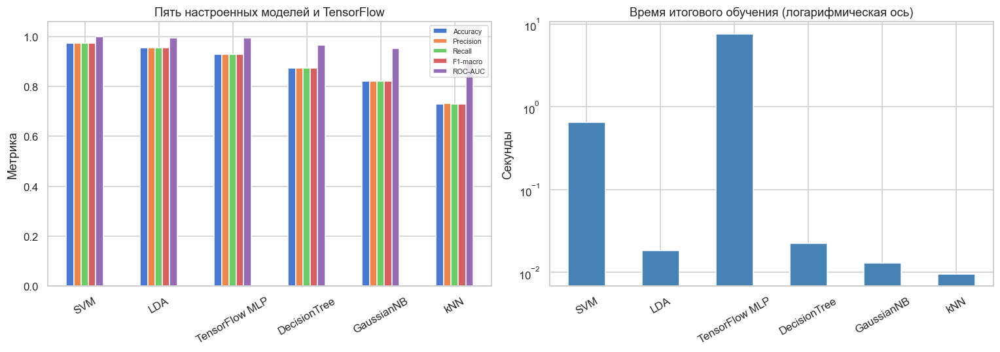

# Mobile Price Classification: классические модели и нейронные сети

Исследование многоклассовой классификации на табличных данных: сравнение Naive Bayes,
дерева решений, LDA, SVM, kNN и полносвязных сетей TensorFlow/Keras.
По 20 характеристикам смартфона модель предсказывает один из четырёх ценовых сегментов.

**Основной результат:** линейный SVM после настройки достиг **97,5% Accuracy**
и **0,9750 F1-macro** на отложенных 400 объектах. Лучшая нейросеть получила
**0,9293 F1-macro**. В этом эксперименте увеличение сложности модели не дало
преимущества перед подходящей классической моделью.

[Исследовательский ноутбук](Lab2_Classification_NeuralNetworks.ipynb) ·
[Таблица результатов](artifacts/final_metrics.csv) ·
[Параметры и отчёт эксперимента](artifacts/experiment_report.json)



## Задача и данные

Исходный набор — [Mobile Price Classification на Kaggle](https://www.kaggle.com/datasets/iabhishekofficial/mobile-price-classification).
Обучающая таблица содержит **2000 строк**, **20 признаков** и целевой столбец
`price_range`: по 500 объектов каждого класса `0`, `1`, `2`, `3`.
Среди признаков — RAM, ёмкость аккумулятора, размеры экрана, разрешение и поддержка связи.

Цель — определить относительный ценовой сегмент исходного набора. Номера классов
не задают цены в рублях и не описывают актуальные рыночные категории смартфонов.
Проект вырос из лабораторной работы и оформлен как воспроизводимое исследование.

В [data/raw/](data/raw/) сохранён снимок исходных `train.csv` и `test.csv`.
Внешний тест исследования — **20% размеченного train.csv**, а не исходный `test.csv`,
в котором нет целевых меток. Происхождение, версия и контрольные суммы файлов —
в [data/source.json](data/source.json). Лицензия набора в метаданных Kaggle указана как
`Unknown`; собственная лицензия для исходных данных здесь не заявляется.

## Результаты

Все строки ниже оценены на одном отложенном наборе из 400 объектов.
Precision, Recall и F1 усредняются по классам с `average='macro'`;
ROC-AUC рассчитывается как среднее четырёх One-vs-Rest AUC.

| Модель | Accuracy | Precision | Recall | F1-macro | ROC-AUC |
| :--- | ---: | ---: | ---: | ---: | ---: |
| **SVM, linear** | **0,9750** | **0,9750** | **0,9750** | **0,9750** | **0,9994** |
| LDA | 0,9550 | 0,9556 | 0,9550 | 0,9552 | 0,9958 |
| TensorFlow MLP | 0,9300 | 0,9305 | 0,9300 | 0,9293 | 0,9958 |
| Decision Tree | 0,8750 | 0,8738 | 0,8750 | 0,8742 | 0,9670 |
| GaussianNB | 0,8225 | 0,8208 | 0,8225 | 0,8214 | 0,9524 |
| kNN | 0,7300 | 0,7315 | 0,7300 | 0,7306 | 0,8916 |

Настройка повысила тестовый F1-macro SVM с **0,8956 до 0,9750**,
а kNN — с **0,5054 до 0,7306**. Числа получены из выполненного кода;
полные результаты до и после настройки, ROC-кривые и матрицы ошибок есть в ноутбуке.

Выбранные параметры:

- **SVM:** `kernel='linear'`, `C=10`, `probability=True`.
- **LDA:** `solver='svd'`.
- **Decision Tree:** `criterion='entropy'`, `max_depth=9`, `min_samples_split=20`.
- **GaussianNB:** `var_smoothing=0.1`.
- **kNN:** 39 соседей, `metric='manhattan'`, `weights='distance'`.
- **MLP:** слои 128 → 64 → 32, ReLU, BatchNormalization, Dropout(0.3), Adam,
  `learning_rate=0.001`; итоговое обучение на 44 эпохах.

## Методология

**Разделение и отсутствие утечки.** Внешнее разбиение 80/20 стратифицировано,
`RANDOM_STATE=42`. При подборе параметров импутер и скейлер входят в `Pipeline`
и обучаются заново внутри каждого CV-фолда. В поиск поступают сырые признаки.
Тестовые результаты базовых моделей используются для описательного сравнения
и не управляют сетками поиска.

**Предобработка под модель.** GaussianNB и остальные классические методы получают
стандартизованные признаки. MultinomialNB и ComplementNB используют неотрицательные
данные после MinMaxScaler с `clip=True`, BernoulliNB — ту же ветку с порогом 0.5.
Пропуски и дубликаты проверяются явно; защитная медианная импутация сохраняется
в пайплайнах, хотя исходный набор не содержит NaN.

**Полный подбор параметров.** Пять семейств классических моделей настроены через
`GridSearchCV` с пятью стратифицированными фолдами по `f1_macro`:
**423 конфигурации, 2115 обучений CV** плюс итоговые refit.
Для каждого семейства построены валидационные кривые и разобран разрыв train/validation.

**Нейросетевые эксперименты.** Исследованы четыре группы: неглубокая сеть,
глубокая сеть без регуляризации, сеть с BatchNormalization/Dropout/EarlyStopping
и влияние трёх learning rate. Всего пять уникальных запусков: контроль `lr=0.001`
в сравнении скоростей обучения повторно использует первую конфигурацию.

Для выбора сети внешний train дополнительно разделён на **1280/320** объектов.
Внутренний препроцессор обучается только на 1280 объектах. Архитектура и число эпох
выбираются по validation loss, затем сеть обучается с нуля на всех **1600** объектах
внешнего train. Тест не используется для выбора архитектуры или остановки.

**Проверка результата.** Генератор сначала выполняет весь ноутбук, затем вставляет
реальные измеренные значения в Markdown. Отдельная проверка воспроизводит
все **30 итоговых метрик** из сохранённых моделей, проверяет 26 выполненных кодовых
ячеек, 16 встроенных PNG и пять наборов TensorBoard-логов.

## Структура проекта

```text
.
├── Lab2_Classification_NeuralNetworks.ipynb  # Выполненное исследование и выводы
├── generate_notebook.py                    # Полный расчёт и генерация отчёта
├── validate_notebook.py                    # Проверка отчёта и сохранённых моделей
├── view_tensorboard.py                     # Просмотр событий TensorBoard
├── requirements.txt                        # Допустимые версии зависимостей
├── requirements-lock.txt                   # Версии проверенного окружения
├── data/
│   ├── raw/train.csv                       # Исходная размеченная таблица
│   ├── raw/test.csv                        # Исходная таблица без целевых меток
│   └── source.json                         # Источник и контрольные суммы
└── artifacts/
    ├── classical_pipelines.joblib          # Пять моделей с предобработкой
    ├── best_neural_network.keras           # Архитектура, веса и состояние оптимизатора
    ├── neural_preprocessing.joblib         # Предобработка и порядок признаков MLP
    ├── final_metrics.csv                   # Итоговые метрики
    ├── final_comparison.png                # Сравнение качества и времени
    ├── experiment_report.json              # Параметры, версии, CV-оценки и время
    ├── exp_*_history.csv                   # Истории пяти запусков MLP
    └── tensorboard/                        # Снимок логов успешного прогона
```

Новые TensorBoard-события создаются в `logs/fit/`; этот рабочий каталог,
виртуальное окружение и диагностические `*.failed.ipynb` исключены из Git.

## Запуск

Проверенное окружение: **Python 3.13.2, scikit-learn 1.9.0, TensorFlow 2.21.0,
Windows x64, CPU**. Полный прогон на использованной машине занял около шести минут;
на другом оборудовании время будет отличаться.

```powershell
git clone https://github.com/GodwynCornelia/2_lb_classification.git
cd 2_lb_classification
python -m venv .venv
.\.venv\Scripts\python.exe -m pip install -r requirements-lock.txt
.\.venv\Scripts\python.exe generate_notebook.py
```

На Linux/macOS используйте `.venv/bin/python`. Для другой поддерживаемой платформы
или версии Python можно установить `requirements.txt`; lock-файл фиксирует именно
проверенное окружение. На другой платформе результаты могут немного отличаться.

Ноутбук можно открыть в Jupyter или VS Code и выполнить **Run All**, выбрав ядро
из `.venv`. Для обновления численных Markdown-выводов после изменения кода или
данных запускайте генератор. По требованию исходного задания он загружает набор
через `kagglehub`; первая загрузка требует интернета, последующие используют кеш.

```powershell
# Проверка сохранённого результата без повторного обучения
.\.venv\Scripts\python.exe validate_notebook.py

# TensorBoard: новые логи или сохранённый снимок из репозитория
.\.venv\Scripts\python.exe view_tensorboard.py
```

Генератор заменяет итоговый `.ipynb` только после успешного расчёта всех ячеек.
При ошибке сохраняется диагностический `*.failed.ipynb`. Таймаут одной ячейки
можно изменить: `python generate_notebook.py --timeout 7200`.

При кириллице в пути проекта на Windows TensorBoard использует временный
ASCII-каталог, затем события копируются обратно в проект. Нужен ASCII-путь к `TEMP`.
В ноутбуке все кривые продублированы статическими изображениями, поэтому для
просмотра исследования запуск TensorBoard не требуется.

## Использование сохранённой модели

Классические модели сохранены вместе с обученными импутером и скейлером.
Пример предсказания SVM по исходному `test.csv`:

```python
import joblib
import pandas as pd

pipelines = joblib.load("artifacts/classical_pipelines.joblib")
model = pipelines["SVM"]
phones = pd.read_csv("data/raw/test.csv")
features = phones[list(model.feature_names_in_)]  # исключает служебный id

predictions = model.predict(features)
probabilities = model.predict_proba(features)   # столбцы: классы 0, 1, 2, 3
```

MLP хранится в `best_neural_network.keras` и принимает стандартизованные признаки.
Перед её применением нужны импутер, скейлер и порядок столбцов из
`neural_preprocessing.joblib`.

## Выводы и ограничения

На этом наборе линейный SVM оказался сильнее исследованных MLP, а LDA дала
конкурентоспособное качество при небольшом времени обучения. Это согласуется
с сильной порядковой связью сегмента с RAM и возможностью описать границы классов
сравнительно простыми моделями. Корреляция сама по себе не доказывает причинность.

Результат относится к одному фиксированному разбиению небольшого учебного набора.
Одна ошибка меняет Accuracy на 0,25 процентного пункта; небольшие различия между
моделями не доказывают статистического превосходства. После сравнения нескольких
моделей на одном тесте следующий этап развития стоит оценивать на новых данных
или через повторную вложенную кросс-валидацию.

Практические направления развития: сравнение с градиентным бустингом,
оценка неопределённости метрик на повторных разбиениях и анализ важности признаков.
Проект демонстрирует исследовательский ML-процесс; качество на новых рыночных
данных и готовность к эксплуатации в продукте здесь не проверялись.

## Дополнительное задание: TensorFlow и 5-fold CV

В ветке `ДОП` добавлено [отдельное исследование](Lab2_Additional_TensorFlow_CV.ipynb):
полный Grid Search по трём архитектурам и трём learning rate, 45 обучений на пяти
стратифицированных фолдах, TensorBoard для каждого запуска и итоговый refit.
Baseline — фиксированная логистическая регрессия. Все сети обучаются одинаковые
60 эпох, предобработка оценивается внутри фолда, тест не управляет подбором.

[Результаты и инструкции дополнительного задания](additional/README.md).
Запуск: `python generate_additional_notebook.py`; проверка сохранённых результатов:
`python validate_additional_notebook.py`; логи: `python view_tensorboard.py --additional`.
