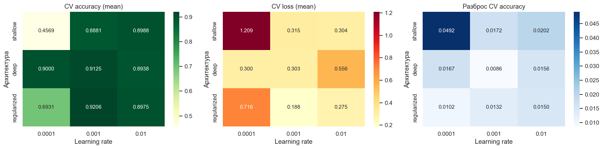
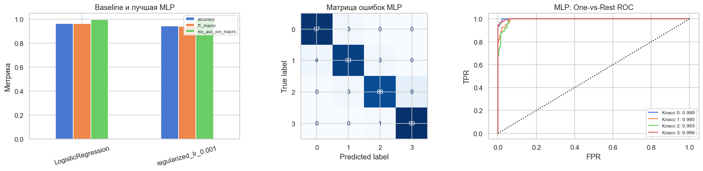

# Дополнительное задание: TensorFlow, 5-fold CV и Grid Search

Ветка `ДОП`, тот же Mobile Price Classification: 2000 смартфонов, 20 признаков, 4 класса.
Главный артефакт — [выполненный ноутбук](../Lab2_Additional_TensorFlow_CV.ipynb).

## Результат полного расчёта

| Показатель | Значение |
| :--- | ---: |
| Конфигураций: 3 архитектуры × 3 learning rate | 9 |
| Обучений на пяти фолдах | 45 |
| Эпох в каждом обучении, включая refit | 60 |
| Победитель | `regularized_lr_0.001` |
| CV accuracy, mean ± std | 0.9206 ± 0.0132 |
| CV loss | 0.1875 |
| Baseline test accuracy (LogisticRegression) | 0.9650 |
| Итоговая MLP test accuracy | 0.9425 |
| Изменение относительно baseline, п.п. | -2.25 |



## Протокол

- Внешнее стратифицированное разбиение 1600/400, seed 42.
- Пять общих стратифицированных фолдов 1280/320; скейлер и импутер обучаются внутри fit.
- Архитектуры: 32 ReLU; 128→64→32 ReLU; такая же глубокая сеть с BatchNorm и Dropout(0.3).
- Learning rate Adam: 0.0001, 0.001, 0.01; batch size 64.
- Ровно 60 эпох: проверочные кривые не управляют EarlyStopping или выбором весов.
- GridSearchCV максимизирует среднюю accuracy; точные равенства разрешаются по loss и std.
- После выбора выполнен один refit на всех 1600 train-объектах.
- Сохранены TensorBoard-логи всех 45 фолдов и refit, истории, OOF-вероятности,
  индексы разбиений, статистики предобработки, baseline и итоговая Keras-модель.

Это повторное учебное сравнение на том же тесте, который уже анализировался в основной
лабораторной. В текущем поиске тест не участвует в выборе параметров. Среднее качество
выбранного CV-кандидата подвержено смещению выбора, std по пяти зависимым фолдам
не является доверительным интервалом. Результат не гарантирует улучшения относительно
линейного baseline; отрицательные дельты сохранены.

## Запуск из корня репозитория

```powershell
git switch ДОП
.\.venv\Scripts\python.exe generate_additional_notebook.py
.\.venv\Scripts\python.exe validate_additional_notebook.py
.\.venv\Scripts\python.exe view_tensorboard.py --additional
```

Зависимости общие с основной работой: `requirements-lock.txt`. На Linux/macOS
используйте `.venv/bin/python`. Для просмотра результатов повторное обучение не нужно.
После изменения кода или данных генератор обновляет измеренные Markdown-выводы.

## Файлы результатов

- [cv_results.csv](artifacts/cv_results.csv) — девять конфигураций и агрегаты CV.
- [fold_metrics.csv](artifacts/fold_metrics.csv) — метрики 45 проверочных фолдов.
- [oof_predictions.csv](artifacts/oof_predictions.csv) — прогнозы каждого объекта в CV.
- [split_manifest.json](artifacts/split_manifest.json), [fit_audit.json](artifacts/fit_audit.json)
  — проверка разбиений и статистик предобработки.
- [final_metrics.csv](artifacts/final_metrics.csv), [experiment_report.json](artifacts/experiment_report.json)
  — финальные оценки и параметры.
- `best_model.keras`, `neural_preprocessing.joblib`, `baseline_logistic.joblib` — модели.
- `history_*.csv`, `tensorboard/` — 46 историй и логов обучения.


